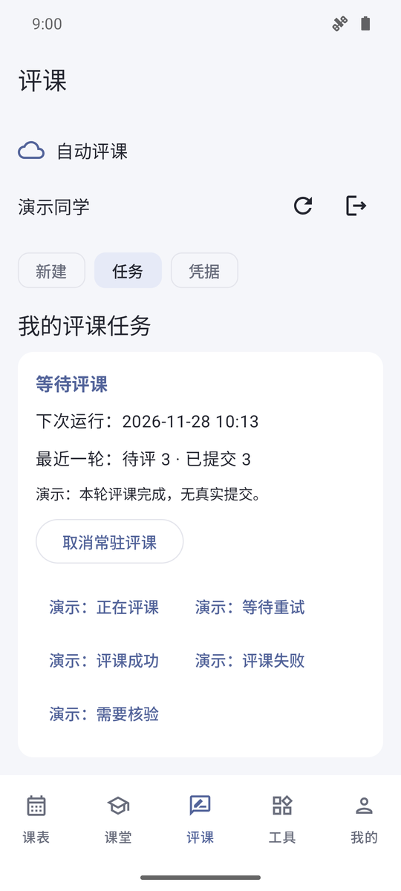

# Nanyee

快来试试这个全新的app吧！
Q:为什么不上架应用市场？ A：国内既要软著还要备案，这玩意肯定过不了？
Q:为什么不考虑Google Play或是Apple Store？ A：好贵啊。前者20刀，后者每年200刀，搞不起搞不起。

**[下载 APK](https://nanyee.de/download)**（国内直连）· [GitHub Releases](https://github.com/apograss/nanyee/releases/latest) ·  Android 8.0+

截图用的是 App 里的演示模式，数据是假的。

## 主要能做什么

**课表**：依照 WakeUp 重置，每门课一种颜色，同一门课同一种颜色。左右滑动切周，每场考试标注于课表上，网考号点击查看。

**雨课堂 PPT**： PPT 可查看后续内容，可在 APP 直接进行答题。（再也不用担心回答不出来 PPT 上面的问题了hh）

**抢课**： 多志愿多次循环抢课，登录后会挤掉教务系统的登录态。（也可去[网站](https://nanyee.de/tools/enrollment)用 cookie 登录）

**自动评课**：可以每天晚上自动评课或是自行手动评课，前者会将教务系统账号与密码加密上传至服务器。

其他功能：成绩和绩点、自习舱自动预约、学习通签到和课堂互动。

## 安装和更新

于[nanyee.de/download](https://nanyee.de/download) 或[GitHub Releases](https://github.com/apograss/nanyee/releases/latest)下载 APK 安装。新版本发布后会自行推送通知，可覆盖更新。

## 关于隐私

学校密码、Cookie 和课表都加密存在你手机上，App 直接连学校的系统。只有你自己打开了自动评课或自习舱预约，账号才会加密存到 nanyee.de，让服务器替你操作，在「我的」里随时可以删掉。

学习通和雨课堂签到用的是真实定位，答题都由你自己填写、确认后才提交。

这不是学校的官方 App。

## 反馈

有问题或想法均可发邮件至 [contact@nanyee.de](mailto:contact@nanyee.de)，或者提 [Issue](https://github.com/apograss/nanyee/issues)。觉得好用的话，「我的 → 捐赠」可以请我喝杯咖啡。

## 开发

`android/` 是 App（Kotlin + Jetpack Compose），说明见 [android/README.md](android/README.md)。nanyee.de 的后端、网站和部署配置见 [docs/backend.md](docs/backend.md)。

App 以 [GPL-3.0](android/LICENSE) 开源。学习通和雨课堂部分移植自 [AneryCoft/course_helper](https://github.com/AneryCoft/course_helper)，感谢原作者。
