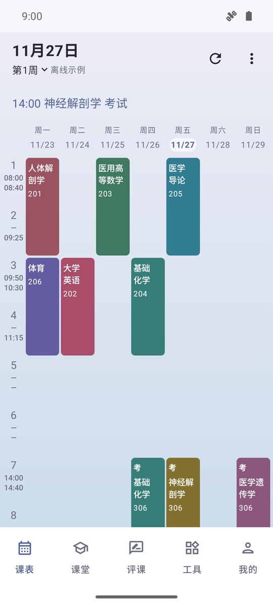
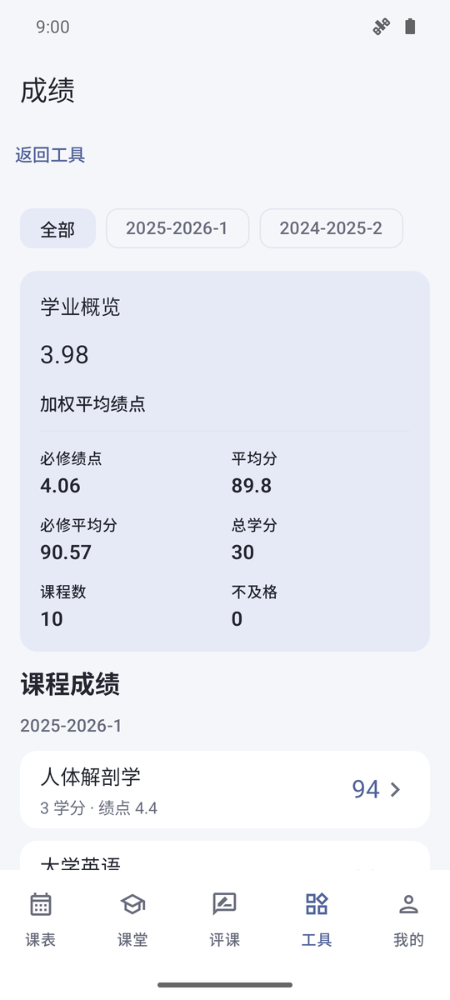
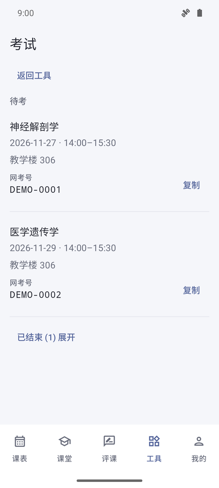

<div align="center">

# Nanyee

**南方医科大学学生的一站式 Android App**

课表 · 考试与网考号 · 成绩 · 评课 · 抢课 · 自习舱 · 学习通 / 雨课堂

[**下载 APK**](https://nanyee.de/download) · [GitHub Releases](https://github.com/apograss/nanyee/releases/latest) · [反馈](mailto:contact@nanyee.de)


[](https://github.com/apograss/nanyee/releases/latest)

</div>

<div align="center">




</div>

<p align="center"><sub>截图为 App 内「演示模式」的示例数据。</sub></p>

## 为什么用 Nanyee

不用再在教务、学习通、雨课堂、评教页面之间来回切换。一个 App，打开就是本周课表。

- **一次登录，之后不用管**：学校验证码在手机上自动识别；勾选「记住」后，登录过期会自动重新登录。
- **离线也能看课表**：课表加密保存在本机，没网、教务崩了也照样看。
- **和 WakeUp 一样好看**：每门课一种颜色，左右滑动切周，考试直接标在课表上。
- **数据直连学校**：除自习舱和自动评课外，所有功能都由手机直接访问学校系统，不经过任何第三方服务器。

## 功能

| | |
|---|---|
| **课表** | 按周查看、左右滑动切周、每门课固定配色、离线可用 |
| **考试** | 考试时间和地点显示在课表上，附带网考号，一键复制 |
| **成绩** | 各学期成绩与加权平均绩点 |
| **评课** | 手动一键评课（逐题可改、提交前预览），或交给服务器自动评课 |
| **抢课** | 多志愿排队、按教务服务器校时定点开抢、冲突确认 |
| **自习舱** | 设定时段和舱位优先级，服务器自动预约 |
| **学习通** | 密码 / 短信 / 扫码登录，签到、投票、问卷、练习、讨论 |
| **雨课堂** | 支持长江、荷塘、黄河等服务器；PPT 大图滑动翻页、全屏缩放、预加载；课堂答题 |
| **更多** | 新版本提醒、演示模式（不登录也能先试用） |

## 下载安装

1. 打开 [nanyee.de/download](https://nanyee.de/download)（国内可直接访问），下载 APK。也可以从 [GitHub Releases](https://github.com/apograss/nanyee/releases/latest) 下载。
2. 允许浏览器安装应用，点击安装。
3. 以后有新版本，App 会提示更新，直接覆盖安装，数据保留。

需要 Android 8.0 及以上。

## 隐私与安全

- 学校密码、Cookie 和课表都用 Android Keystore 加密保存在本机，不备份、不上传。
- 只有你主动开启**自习舱预约**或**自动评课**时，才会把学校凭据加密托管到 nanyee.de，用于服务器替你执行；随时可以在「我的」里删除。
- 学习通 / 雨课堂的签到使用手机真实定位，拒绝模拟位置；所有作答都由你本人填写并确认后提交，不代签、不自动答题。
- 代码完全开源，可以自己审查和编译。

> **非官方项目**，与南方医科大学无隶属关系。请遵守学校规定，合理使用。

## 反馈与支持

- 邮件：[contact@nanyee.de](mailto:contact@nanyee.de)（App 内「我的 → 反馈」会自动带上版本和机型）
- 问题与建议：[GitHub Issues](https://github.com/apograss/nanyee/issues)
- 觉得好用的话，可以在「我的 → 捐赠」请作者喝杯咖啡

## 开发者

本仓库同时包含 Android App 和 nanyee.de 的后端与网站：

| 目录 | 内容 | 文档 |
|---|---|---|
| `android/` | Kotlin · Jetpack Compose · Material 3 原生客户端 | [android/README.md](android/README.md) |
| `services/`、`web/`、`infra/` | FastAPI 后端、Worker、React 网站、部署配置 | [docs/backend.md](docs/backend.md) |

```sh
cd android
./gradlew assembleDebug testDebugUnitTest
```

## 许可

Android App 以 [GPL-3.0](android/LICENSE) 发布，其中学习通与雨课堂部分移植自 [AneryCoft/course_helper](https://github.com/AneryCoft/course_helper)，感谢原作者。课表界面参考了 WakeUp 课程表的设计。
