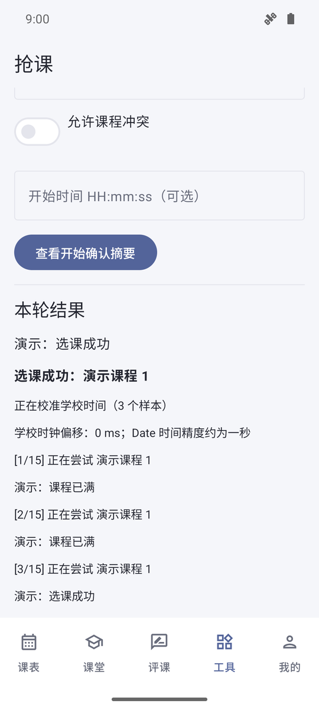

# Nanyee

给南医学生写的 Android App。打开就是课表，雨课堂、抢课、评课也都在里面。

**[下载 APK](https://nanyee.de/download)**（国内直连）· [GitHub Releases](https://github.com/apograss/nanyee/releases/latest) · 需要 Android 8.0+

截图用的是 App 里的演示模式，数据是假的。

## 主要能做什么

**课表**：按 WakeUp 的样子做的，每门课一种颜色，同一门课永远是同一种颜色。左右滑动切周，考试会直接标在课表上，网考号点一下就能复制。课表存在手机里，没网、教务崩了也能看。

**雨课堂 PPT**：PPT 是整屏宽的大图，左右滑动翻页，点开可以全屏、双指放大。翻页时前后两页已经提前加载好了，不用每翻一页等一下。下拉刷新，保存本页或整套 PPT 都在下面的「更多」里。

**抢课**：可以排好几个志愿，按教务服务器的时间对好表，到点自动开抢。抢到了就停，撞课会先问你。

**自动评课**：交给服务器，它会自己登录教务，把待评的课一次评完，不用一门门点。想自己评也行，一键填好，每题都能改，提交前可以先看一遍。

其他还有：成绩和绩点、自习舱自动预约、学习通签到和课堂互动。登录验证码在手机上自动识别，过期了会自己重新登录。

没有学校账号也能先用演示模式看看。

## 安装和更新

从 [nanyee.de/download](https://nanyee.de/download) 下载 APK 安装就行。以后有新版本 App 会提醒，下载后直接覆盖安装，数据都在。

## 关于隐私

学校密码、Cookie 和课表都加密存在你手机上，App 直接连学校的系统。只有你自己打开了自动评课或自习舱预约，账号才会加密存到 nanyee.de，让服务器替你操作，在「我的」里随时可以删掉。

学习通和雨课堂签到用的是真实定位，答题都由你自己填写、确认后才提交。

这不是学校的官方 App。

## 反馈

有问题或想法发邮件到 [contact@nanyee.de](mailto:contact@nanyee.de)，或者提 [Issue](https://github.com/apograss/nanyee/issues)。觉得好用的话，「我的 → 捐赠」可以请我喝杯咖啡。

## 开发

`android/` 是 App（Kotlin + Jetpack Compose），说明见 [android/README.md](android/README.md)。nanyee.de 的后端、网站和部署配置见 [docs/backend.md](docs/backend.md)。

App 以 [GPL-3.0](android/LICENSE) 开源。学习通和雨课堂部分移植自 [AneryCoft/course_helper](https://github.com/AneryCoft/course_helper)，感谢原作者。
