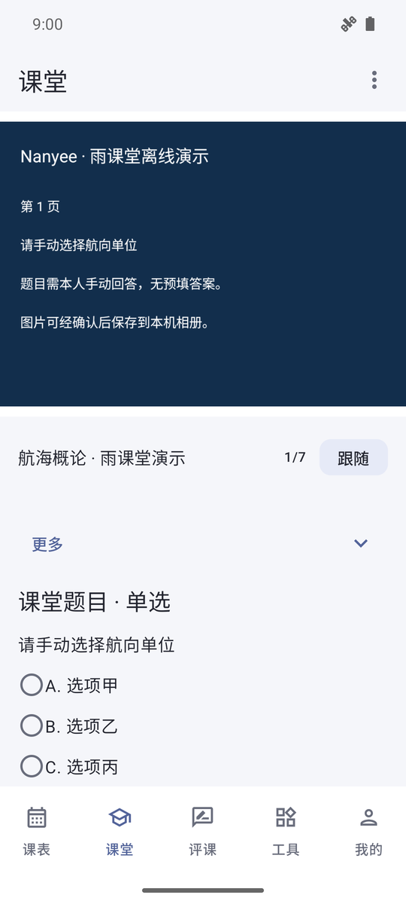

# Nanyee

Nanyee 是一款面向本校学生的 Android 应用，集成课表、雨课堂、抢课和自动评课等功能。

**[下载 APK](https://nanyee.de/download)**（国内直连）· [GitHub Releases](https://github.com/apograss/nanyee/releases/latest) · 需要 Android 8.0 及以上

<p>




</p>

<sub>截图来自 App 内置的演示模式，所示数据均为虚构。</sub>

## 功能

### 课表

- 界面参考 WakeUp 设计，同一门课程使用统一配色，左右滑动切换周次。
- 考试安排直接标注在课表中，点击即可查看考试时间、地点和网考号，网考号可一键复制。
- 课表加密缓存在本机，断网或教务系统不可用时仍可查看。

### 雨课堂

- 支持长江、荷塘、黄河等雨课堂服务器，可使用密码、短信或扫码登录。
- 课件提前加载，可以翻看老师尚未放映的页面；左右滑动翻页，点击进入全屏并支持双指缩放。
- 翻页时自动预加载前后页面，减少等待；可保存当前页或整套课件。
- 课堂习题可在 App 内直接作答。

### 抢课

- 支持设置多个志愿并循环提交，按教务服务器时间校准后定时开始。
- 选中即停止；遇到时间冲突会先征求确认。
- 登录 App 会使教务系统中已有的登录状态失效；如需保留，也可以在[网页版](https://nanyee.de/tools/enrollment)中使用 Cookie 登录。

### 评课

- **自动评课**：可选择每晚自动完成评课。需要将教务系统账号和密码加密上传至服务器。
- **手动评课**：一键填写，逐题可修改，提交前可预览，全程在本机完成。

### 其他

| 功能 | 说明 |
|---|---|
| 成绩 | 各学期成绩与加权平均绩点 |
| 自习舱 | 设定时段与舱位优先级，由服务器自动预约 |
| 学习通 | 签到、投票、问卷、练习与讨论 |
| 自动登录 | 验证码在本机识别，登录过期后自动重新登录 |
| 推荐 | 校友常用的工具、站点与博客 |
| 演示模式 | 无需学校账号即可体验全部界面 |

## 安装与更新

1. 从 [nanyee.de/download](https://nanyee.de/download) 或 [GitHub Releases](https://github.com/apograss/nanyee/releases/latest) 下载 APK。
2. 按系统提示允许浏览器安装未知来源应用，完成安装。
3. 有新版本时 App 会提示更新，下载后直接覆盖安装，数据保留。

每个版本的 SHA-256 校验值和对应源码包均随 Release 一同发布。

**为什么不上架应用商店？** 国内应用市场上架需要软件著作权和 ICP 备案，目前不具备条件；Google Play 和 App Store 的开发者费用（分别为 25 美元一次性和每年 99 美元）对个人项目来说也不划算。

## 隐私

- 学校账号密码、Cookie 和课表数据均使用 Android Keystore 加密保存在本机，不参与系统备份，App 直接与学校系统通信。
- 只有在启用自动评课或自习舱预约时，账号才会加密存储到 nanyee.de，由服务器代为执行，可随时在「我的」页面中删除。
- 学习通和雨课堂签到使用设备的真实定位，拒绝模拟定位；所有答题内容都由用户本人填写并确认后才会提交。
- 源代码完全公开，可自行审查和编译。

本项目与学校无关，不是学校官方应用。

## 反馈

问题和建议请发送邮件至 [contact@nanyee.de](mailto:contact@nanyee.de)（App 内「我的 → 反馈」会自动附带版本号和机型），或提交 [Issue](https://github.com/apograss/nanyee/issues)。如果觉得好用，可以在「我的 → 捐赠」中支持开发。

## 开发

| 目录 | 内容 | 文档 |
|---|---|---|
| `android/` | Android App：Kotlin、Jetpack Compose、Material 3，验证码识别使用 ONNX Runtime | [android/README.md](android/README.md) |
| `services/`、`web/`、`infra/` | nanyee.de 后端（FastAPI、Worker）、React 网站与部署配置 | [docs/backend.md](docs/backend.md) |

```sh
cd android
./gradlew assembleDebug testDebugUnitTest
```

## 许可

App 以 [GPL-3.0](android/LICENSE) 协议开源。学习通和雨课堂模块移植自 [AneryCoft/course_helper](https://github.com/AneryCoft/course_helper)，感谢原作者。
